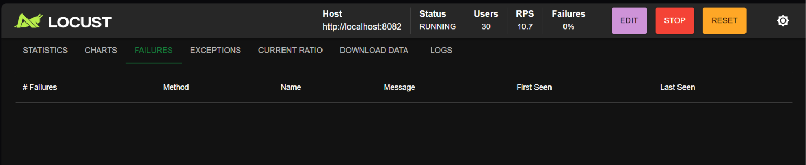

______

# Respuesta de preguntas (Ejercicio 2)

## Diagnostico de la reaccion en cadena (Cascading Failure)

### ¿Por qué el healthcheck de Docker empieza a fallar si la ruta /health solo hace un return "OK" instantáneo?

#### Porque se estamos configurando solo 2 trabajadores en gunicorn, estos 2 trabajadores estan ocupados atendiendo a las otras peticionaes, para cuando llega el momento de evaluar el /health, no hay algun trabajador disponible para que se pueda ejecutar la evaluacion, para cuando los trabajadores esten disponibles, el segundo de timeout que configuramos en el docker compose, ya sucedio y ya se perdio dicho diagnostico por hacer.

## Bucle Infinito

### Cuando la Réplica 1 se marca como unhealthy y se reinicia, ¿qué ocurre con el tráfico que estaba atendiendo? ¿A dónde lo envía Nginx?

#### Al momento de que una replica este marcada como unhealthy, docker la va a reiniciar y nginx lo pasa a las repliecas que quedan

### ¿Por qué el reinicio de una réplica provoca que las 3 réplicas sobrevivientes se caigan inmediatamente después?

#### Porque como tenemos establecido tan poco tiempo, estas replicas se van saturando y se van paso asi mismo a la siguiente replica, lo que nos da el bucle y hace que generen los 502 expresando que la conexion se rompio

## Propuesta de Solución Lógica (Sin aumentar CPU a la máquina)

### ¿Qué parámetro o tipo de trabajador (worker class) permitiría atender peticiones lentas de E/S o tiempo de espera sin bloquear el hilo principal del healthcheck?

#### Usaremos gevent porque se va a enfocar en las peticiones lentas de E/S premitiendo que no se bloquee el hilo principal de peticiones healthcheck

### Reconfiguren interval, timeout y retries en el docker-compose.yml de forma coherente con el tiempo de respuesta real de la aplicación.

#### vamos a aumentar el timeout para que le de mas tiempo de respuesta a las replicas.

## Evidencia visual

## 0 errores 502

## Justificacion tecnica

#### sucede porque ahora estamos manejando las peticiones lentas especificamente con gevents y esto permite que no se colapsen las peticiones y alcance a dar atencion a las peticiones /health sin errores, adicional le estamos configurando mas tiempo de respuestaa las replicas
______

