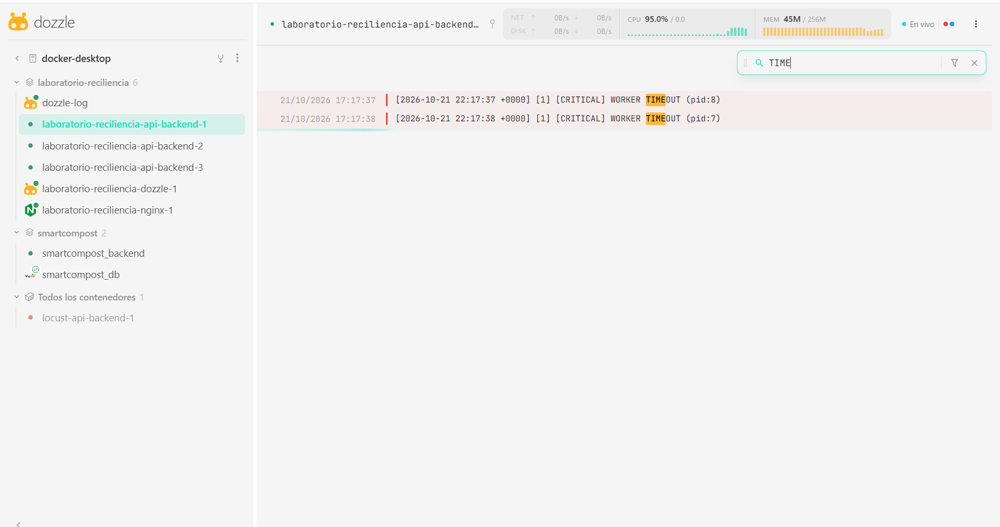
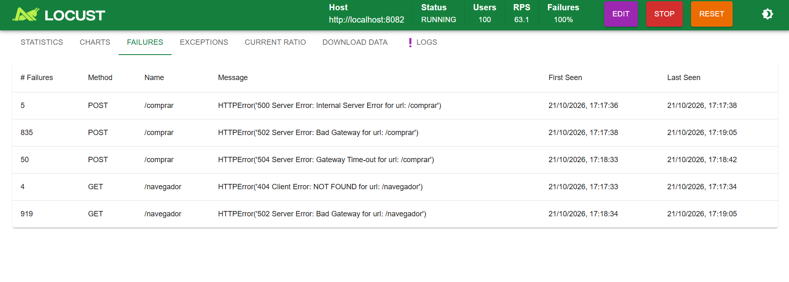
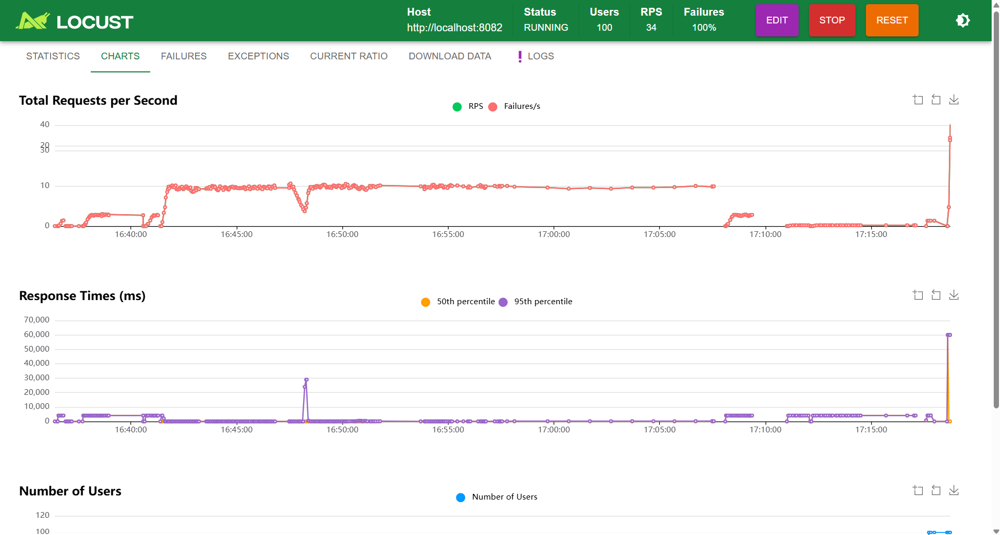

______

# Post-Mortem

## Captura de pantalla de Dozzle filtrando el evento de error de Gunicorn (WORKER TIMEOUT)

## Captura de pantalla del gráfico de latencia de Locust mostrando el momento del fallo.

## Identificación de la Síntoma

### ¿Qué código de estado HTTP devuelve Nginx (nginx-balanceador)?

#### 

### ¿qué mensaje de error exacto aparece en los logs del Backend (api-backend) cuando las peticiones empiezan a fallar?

####

## Diagnóstico de la Causa Raíz (Análisis SRE) Si el código Python no tiene ninguna sintaxis errónea ni lanza excepciones no capturadas (Tracebacks)

### ¿Por qué Gunicorn está matando los procesos trabajadores (Worker Timeout)?

####

### ¿Qué relación existe entre la duración de la simulación (time.sleep(4)) y el parámetro -t 3 de Gunicorn?

####

## Efecto Domino en la Arquitectura

### ¿Qué sucede con los 15 usuarios de Locust cuando las 2 réplicas de la API (cada una con solo 2 workers) se quedan sin hilos libres para atender peticiones entrantes?

####

### ¿Cómo interpreta Nginx la falta de respuesta de los contenedores tras bambalinas?

####

## Propuesta de Solución

### Primer cambio concreto en la configuración

####

### Segundo cambio concreto en la configuración

####

______
